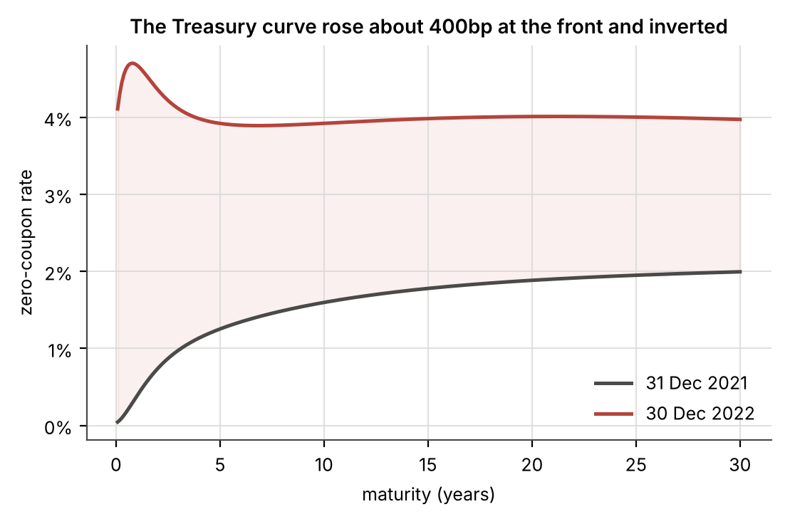
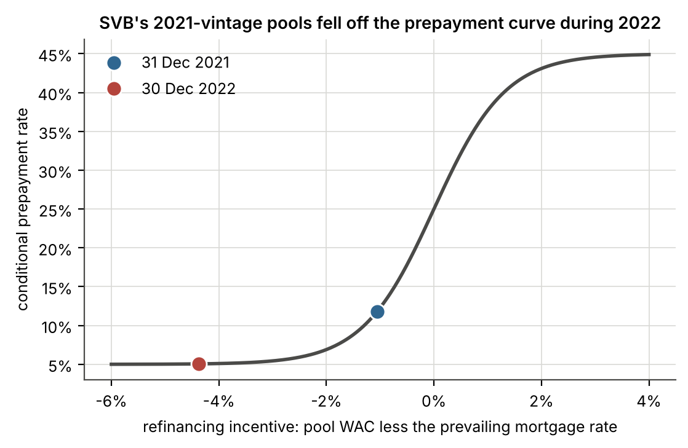
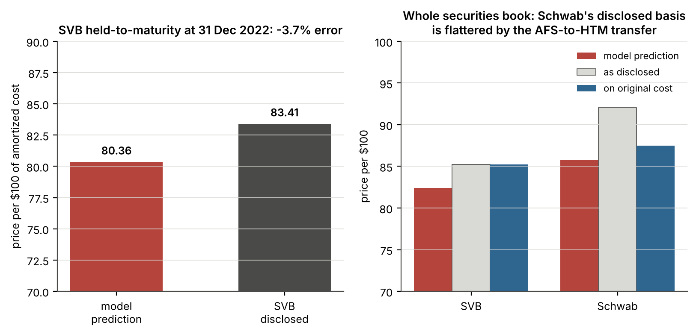
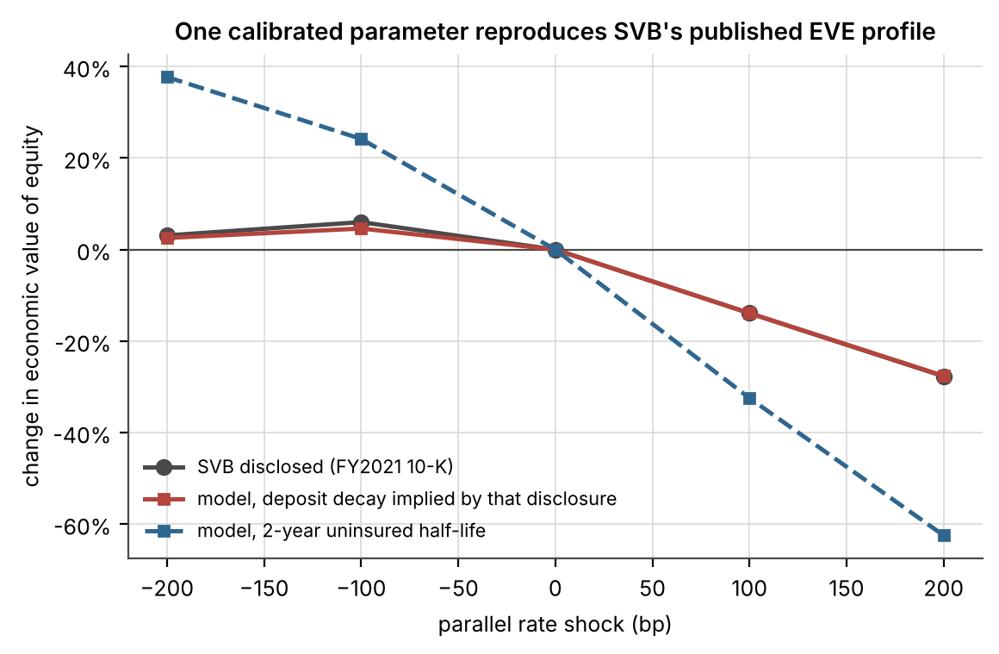
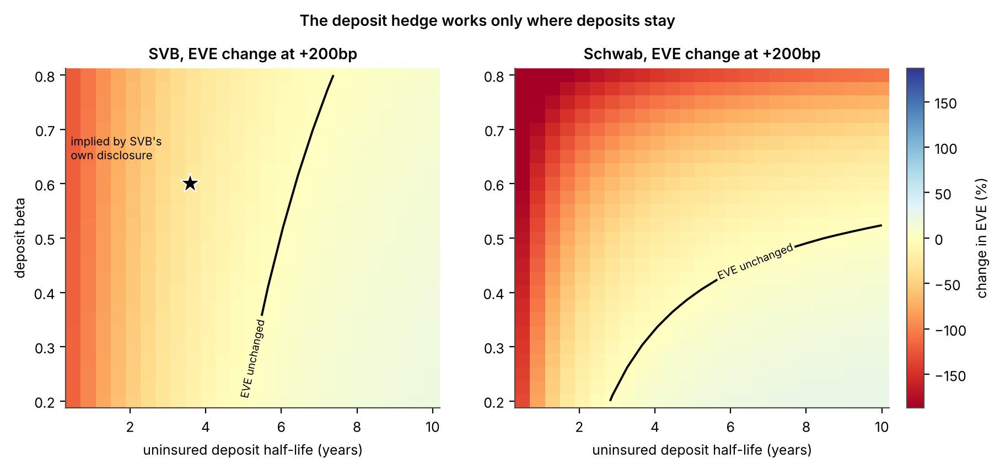
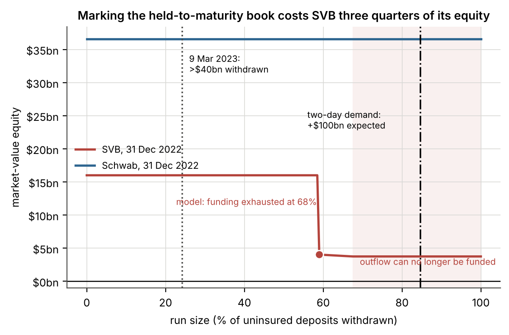

# SVB's Missing EVE

**Rebuilding interest-rate and deposit-run risk from public filings: SVB Financial
Group against The Charles Schwab Corporation, 2021–2022**

---

## 1. The question

On 1 March 2022, SVB Financial Group filed a 10-K that told its readers how much
interest rate risk the bank was carrying. Item 7A of that filing put the economic value
of equity at $20,672m and set out what parallel rate shocks would do to it: down 13.9%
at +100bp, down 27.7% at +200bp. The bank also disclosed, in the same section, that the
+100bp figure would have been −15.4% without the pay-fixed swaps it had bought in March
2021.

On 24 February 2023, two weeks before the bank was closed, SVB filed its FY2022 10-K.
Item 7A of that filing contains no EVE figure. It reports the sensitivity of twelve-month
net interest income, in percentage terms only (+3.5% at +200bp), and nothing about
economic value. The EVE table, the dollar amounts, the base level: all gone. Both
filings are in `references/sec_filings/`, and the comparison is made by reading them
side by side rather than asserted.

Schwab never published an EVE figure in either year. What it discloses is a simulated
change in net interest revenue from a *gradual* 100bp move — +14.1% at end-2021, +3.6%
at end-2022 — which is a different measure of a different thing.

So the question this project asks is narrow and testable. Using only what SVB had
already put in the public record by the end of 2021, can the exposure that later killed
it be measured? And when the same framework is pointed at Schwab, which carried
comparable securities losses through 2022 and did not fail, what separates them?

## 2. What the filings already said

Three facts sit on the face of these documents and do most of the explanatory work
before any model is built.

**SVB had bought a very long book at the bottom of the rate cycle.** Held-to-maturity
securities went from $16.6bn at end-2020 to $98.2bn at end-2021, an increase of $81.6bn
driven by $85.6bn of purchases. Of the $98.2bn, $93.2bn, or 95%, sat in the
over-ten-years contractual maturity bucket, yielding 1.61%. Agency MBS alone accounted
for $64.4bn at a 1.55% book yield.

**Its funding was almost entirely uninsured.** SVB disclosed $166.0bn of estimated
uninsured deposits in U.S. offices at end-2021, plus $16.1bn of foreign deposits outside
any U.S. insurance regime, against $189.2bn of total deposits. That is 96% of the
deposit base outside the FDIC limit. Schwab disclosed $134.8bn of uninsured deposits
against $443.8bn, or 30%.

**Neither bank's regulatory capital reflected its securities losses.** Both elected the
AOCI opt-out. SVB's FY2022 capital reconciliation adds back $1,880m of accumulated other
comprehensive loss to arrive at CET1; Schwab's adds back $22,620m. Schwab's CET1 ratio
*rose* in 2022, from 19.7% to 21.9%, in a year its AOCI fell by $21.5bn after tax.

*Figure 1. The curve the book was bought into and the curve it was marked against. On
the bootstrapped zero curve the two-year rate went from 0.74% to 4.36% across 2022 and
the ten-year from 1.60% to 3.92%. Treasury's published par yields for the same two
tenors are 0.73% and 4.41%, and 1.52% and 3.88%: close at the short end, and far enough
apart further out to matter for a book with this much duration.*

## 3. How the reconstruction works

The pipeline runs in the order its dependencies require, and each stage asserts
something about its own output rather than trusting the stage before it.

**Extraction.** The four 10-K filings are inline-XBRL documents. Their tables are parsed
into versioned CSVs under `data/raw/`, with the arithmetic checked rather than assumed:
component lines must sum to stated totals, maturity buckets to their own total line,
amortized cost plus gains plus losses to fair value under a single sign convention, and
extracted Tier 1 dollars divided by RWA must reproduce the ratio each filing published.
SVB's FY2021 NII sensitivity is cross-checked against the comparative column its FY2022
filing reprints.

Two conventions in these documents will corrupt a careless parse silently. An em-dash
cell means zero while a blank cell is layout padding, and conflating them shifts every
later figure in a row one column left, which reads SVB's agency CMO fair value as an
unrealized loss. And Schwab writes negative percentages as `(4.5)%`, with the percent
sign outside the bracket, which defeats a parser that tests for a trailing `)` before
stripping symbols. Both are covered by tests.

**Curve construction (Module B).** Treasury publishes *par* yields. Zero rates are
bootstrapped from them by solving each node so a par bond of that maturity prices to
exactly 100, with intermediate coupon dates interpolated against the trial long rate so
that the resulting curve reprices its own par bonds to machine precision. Nelson–Siegel–
Svensson is then fitted by minimising par-yield error rather than error against the
bootstrapped zeros: fitting the zeros directly spends the model's flexibility matching
bootstrap noise in the 20- and 30-year sector and misprices the ten-year par bond by
10bp. Worst residual is 8.7bp at end-2021 and 10.1bp at end-2022, both at the twenty-year
point, which trades at a concession no four-parameter family can reach without
distorting the tenors that matter more here.

**Short rate (Module C).** A one-factor Hull–White model, with θ(t) fitted analytically
so the model reproduces the fitted forward curve exactly at time zero. Mean reversion
and volatility are estimated from the historical three-month bill. That specification
needed care: run daily on a 2003–2022 window, the regression returns a mean reversion
speed of 0.002, a half-life of 365 years, an implied long-run mean of 86% and an R²
of 0.00000, because more than half those years sit at the zero bound where the level
carries no information about the next change. Monthly sampling from 1990 gives a
7.8-year half-life, 62bp of volatility and a 1.76% long-run mean. The full grid is
reported by `calibration_sensitivity()` and a guard rejects degenerate fits.

**Securities (Module D).** Pass-throughs are valued pathwise: prepayment is a logistic
function of refinancing incentive, the incentive is computed along each simulated rate
path from the model's own ten-year zero plus the observed primary-secondary spread, and
cash flows are discounted on the same path. Bullets price analytically off the fitted
curve. Agency CMBS is treated as a bullet on purpose: K-deal and DUS collateral carries
lockout and yield maintenance, so applying a residential refinancing curve to it would
invent an option those bonds do not grant.

*Figure 2. Where SVB's HTM agency MBS sat on the prepayment curve at each date. A pool
whose borrowers pay around 2% has no reason to refinance into a 6.4% mortgage, so
principal stops coming back early and the book's effective life extends from 6.6 to 9.1
years at the moment the bank most needs it to shorten.*

One option-adjusted spread per security type is solved so the model reproduces the fair
value that type's note discloses at 31 December 2021. SVB's HTM agency MBS comes out at
10bp, which is where agency paper should sit. Every type reprices exactly, with one
exception: a $100m variable-rate CMO prices at par whatever the spread, so no finite OAS
reaches the $101m the filing shows. The residual is $0.27m on a $98bn book and the
diagnostic flags it rather than hiding it.

## 4. The out-of-sample test

All spreads are then **frozen**. Pools are aged twelve months using the end-2021 model,
so how much principal came back during 2022 is a prediction made at end-2021 rather than
a fact read off the 2022 filing. Only the discount curve changes, to the one actually
observed.

| | model | SVB disclosed | error |
|---|---|---|---|
| **HTM, price per $100 of amortized cost** | **80.36** | **83.41** | **−3.7%** |
| AFS, price per $100 | 89.28 | 91.14 | −2.1% |

SVB's disclosed figure is $76,169m of fair value against $91,327m of amortized cost. The
model predicts a slightly *larger* loss than the bank reported, which is the
conservative direction for an exercise of this kind.

*Figure 3. Left: the headline test. Right: whole securities books, showing why Schwab's
disclosed basis cannot be compared with SVB's without adjustment.*

### Why Schwab needed an accounting correction

Schwab's first result came in at −7.2% and chasing it rather than reporting it found two
things.

The first was a modelling error. Every mortgage pool was being given a 25-year
weighted-average maturity regardless of which contractual maturity bucket it sat in. SVB
keeps 98.6% of its pass-throughs beyond ten years so it barely noticed; 29% of Schwab's
sits in shorter buckets, where a 25-year life roughly doubles duration. Remaining life
now comes from the bucket, and the correction was propagated back through the OAS
calibration.

The second was not a model problem at all. A security transferred out of
available-for-sale is rebased to its fair value on the transfer date; the unrealized loss
moves to AOCI and amortises over the remaining life rather than staying visible in the
securities note. Schwab's FY2022 filing discloses the two transfers precisely: aggregate
fair values of $108.8bn in January and $79.8bn in November, carrying net unrealized
losses at transfer of $2.4bn and $15.8bn. So $206.8bn of original cost moved at $188.6bn,
and $18.2bn of loss left the securities note. With $707m amortised back during the year,
$17.5bn was still unamortised at year end.

Restore it and the comparison becomes like-for-like:

| | predicted | as disclosed | on original cost |
|---|---|---|---|
| SVB, both classifications | 82.40 | 85.25 | 85.25 (no adjustment needed) |
| Schwab, both classifications | 85.72 | 92.07 | **87.47** |

Against the disclosed basis the Schwab error is −6.35 points. Against what Schwab
actually paid it is −1.75 points, or **−2.0%**. SVB bought its HTM book rather than
transferring into it. It re-designated only $8.95bn during 2021, carrying $132m of loss,
0.1% of the book, so its disclosed unrealized loss is the whole economic loss, and
Schwab's understates its own by roughly $17.5bn.

Both banks' errors share a sign. Two independent portfolios missing in the same direction
points at model bias rather than sampling noise, so the next section asks which
assumption is responsible.

### Which assumption carries the error

Thirteen variants of the end-2022 test, each changing one judgement call and holding
everything else including the random seed fixed:

| variant | predicted price | error |
|---|---|---|
| base case | 80.35 | −3.7% |
| over-10y bullet maturity 15y | 81.43 | −2.4% |
| over-10y bullet maturity 25y | 79.52 | −4.7% |
| pass-through life 20y | 81.48 | −2.3% |
| pass-through life 28y | 79.80 | −4.3% |
| prepayment floor 2% / ceiling 60% | 78.30 | −6.1% |
| prepayment floor 8% / ceiling 35% | 81.90 | −1.8% |
| prepayment curve twice as steep | 80.71 | −3.2% |
| servicing and guarantee fee 25bp | 80.51 | −3.5% |
| servicing and guarantee fee 75bp | 80.14 | −3.9% |
| mean reversion half-life 14y (a = 0.05) | 80.63 | −3.3% |
| mean reversion half-life 4.6y (a = 0.15) | 80.12 | −3.9% |
| short-rate volatility 100bp | 81.04 | −2.8% |

Three things come out of this, and the first contradicts what I expected.

The short-rate calibration is not the culprit. Widening the prepayment S-curve moves the
answer by two points and shortening the representative maturities by about one, but
halving or near-doubling the mean reversion speed moves it by three tenths of a point,
and taking volatility from 62bp to 100bp moves it by two thirds of a point. Whatever the
historical rather than risk-neutral calibration costs in realism, it is not what is
producing a three-point gap. The plausible first guess was wrong and the sweep is what
showed it.

Every variant under-predicts. Not one of the thirteen lands above the disclosed price.
A bias that survives this much variation in the assumptions is structural rather than
parametric, and the most likely candidate is the bullet approximation applied to the
non-mortgage third of the book: $15.0bn of agency CMBS and $7.2bn of municipals in the
over-ten-years bucket are priced as par bonds at a 20-year representative maturity, when
both almost certainly have shorter effective lives than that. Shortening that bucket to
15 years closes a third of the gap on its own.

And the result is not fragile. Across every variant the prediction spans 3.6 points, from
78.30 to 81.90, and the error never exceeds 6.1%. The headline is not resting on a lucky
parameter.

## 5. The second test, and the finding underneath it

SVB's FY2021 disclosure allows a far harder check than the securities one, because it
exercises both sides of the balance sheet. The asset side is pinned down by the
securities the bank disclosed. Deposits are the only genuinely free parameter left. So
rather than assuming a deposit decay and seeing what EVE sensitivity falls out, the
question can be inverted: given that SVB published −13.9% at +100bp, how long did its
model need those deposits to stay?

Solving that single parameter, holding beta at the 60% SVB itself disclosed, gives an
**uninsured deposit half-life of 3.59 years**. At that one calibrated value, everything
else follows uncalibrated:

| | model | SVB disclosed |
|---|---|---|
| base EVE | $21,271m | $20,672m |
| +100bp | −13.9% | −13.9% ← the one fitted point |
| **+200bp** | **−27.6%** | **−27.7%** |
| −100bp | +4.6% | +6.0% |
| −200bp | +2.5% | +3.1% |

The +200bp figure was not fitted. Neither was the base level, nor the shape of the down
shocks — which are positive, small, and *non-monotonic*, with −100bp producing more gain
than −200bp. That non-monotonicity comes out of the zero floor interacting with negative
convexity, and the model reproduces it without being asked to.

*Figure 4. The red line is the model with the deposit decay implied by SVB's own
+100bp disclosure. The grey is what SVB published. The blue dashed line is the same
balance sheet with a two-year uninsured half-life.*

That gap between the red and blue lines is the whole argument. Nothing on the asset side
differs between them. The only thing that changed is how long the deposits are assumed to
stay, and it moves the +200bp answer from −27.6% to −62.5%.

### The hedge, and what it rests on

Drechsler, Savov and Schnabl (2021) make the case that a deposit franchise hedges
interest rate risk rather than creating it: deposit rates are low and insensitive to
market rates, so a bank that lends long at fixed rates is matching its income
sensitivity to its expense sensitivity, not mismatching it. The mechanism is real and
Module E implements it directly. As rates rise, the spread earned on below-market funding
widens, the liability cheapens, and the fall in asset values is offset.

The hedge has one precondition, and it is behavioural rather than financial. It is paid
for entirely by the assumption that the deposits stay.

*Figure 5. Change in EVE at +200bp across the grid of deposit beta and uninsured
half-life. The black contour is where the hedge exactly offsets the asset loss. The star
marks the point implied by SVB's own disclosure.*

Two features of this figure are worth reading carefully.

SVB's contour is nearly vertical: beta barely matters, half-life is almost everything.
That is a direct consequence of its funding mix: 67% of SVB's deposits were
non-interest-bearing at end-2021, and a balance paying nothing has no beta to speak of.
Schwab's contour bends, because essentially all of its deposits were interest-bearing and
the pass-through rate does real work.

And for SVB, the point implied by its own disclosure sits just inside the region where
the hedge still mostly works. Move left — shorten the assumed half-life — and it stops.
Whether 3.6 years is a reasonable half-life for a deposit base that was 96% uninsured,
concentrated in venture-backed technology, and held by depositors who talked to each
other, is not a question a model can settle. It is the question.

## 6. Run risk

An underwater securities book is not a solvency problem while the bank can hold it. It
becomes one the moment the bank has to sell, and what forces a sale is depositors
leaving. Module G funds a withdrawal through a strict waterfall: cash, then secured
borrowing after a collateral haircut, then sales of available-for-sale securities, then
sales of held-to-maturity securities.

The last step is a cliff rather than a slope. Under ASC 320, selling HTM securities for
reasons outside a narrow set of permitted exceptions calls the intent to hold into
question for the entire portfolio. A bank that sells one dollar of HTM recognises the
unrealized loss on all of it.

| | SVB end-2021 | SVB end-2022 | Schwab end-2022 |
|---|---|---|---|
| uninsured share of deposits | 96.2% | 95.5% | 18.8% |
| book equity | $16,236m | $16,004m | $36,608m |
| HTM unrealized loss | $968m | $15,152m | $14,138m |
| after-tax cost of tainting | $765m | $11,970m | $11,169m |
| **as % of book equity** | **4.7%** | **74.8%** | **30.5%** |

At the end of 2021, marking SVB's HTM book would have cost it under 5% of equity. A year
later the same action cost three quarters of it.

*Figure 6. Equity as a function of how much of the uninsured deposit base withdraws.
The drop is the HTM taint. The shaded region is where the waterfall is dry and the
outflow can no longer be funded at all.*

The model says SVB could have funded withdrawals up to **67.5% of uninsured deposits**,
about $111.6bn, before running out of assets to pledge or sell. Past that it fails on
liquidity, not on accounting equity: even after fully marking the HTM book it retains
roughly $4.0bn, and that cushion survives a complete liquidation only while the
forced-sale discount stays under about 4%.

What actually happened, as the Federal Reserve's April 2023 review records: over $40bn
was withdrawn on 9 March 2023, with management expecting $100bn more the following day,
together "roughly 85 percent of the bank's deposit base". Against uninsured deposits
that two-day demand is 84.6%, comfortably beyond the modelled threshold of 67.5%.

Schwab never reaches either threshold at any run size on this grid. Its $68.9bn of
uninsured deposits at end-2022 sit against $40.2bn of cash and $306.8bn of securities at
fair value. Its equity stays above $31bn even in the worst cell of the sensitivity grid:
no secured borrowing at all, and a 15% discount on everything sold.

## 7. What separated them

On interest rate risk alone, both banks were outliers. Run the six BCBS standardised
shocks against Tier 1 capital and both breach the 15% supervisory threshold at both
year-ends, by wide margins, under common deposit assumptions. Even on SVB's *own*
disclosed sensitivity — the −27.6% at +200bp that its FY2021 Item 7A implies — the
worst-case EVE loss is roughly 36% of Tier 1, more than twice the threshold. SVB was a
supervisory outlier on the numbers it published itself.

What differed was the funding. SVB's securities losses and Schwab's were of comparable
character; Schwab's were larger in absolute terms. The difference was that 96% of SVB's
deposits could leave and 30% of Schwab's could, and that SVB's depositors were a
concentrated, connected population with every incentive to move first.

The deposit franchise is a genuine hedge against rising rates. It is not a hedge against
depositors leaving — and for a bank whose deposits are overwhelmingly uninsured, those
two risks are not independent. Rising rates are precisely what gives an uninsured
depositor somewhere better to go.

## 8. What this model does not do

The limitations that would move a number:

- **Book yields stand in for coupons.** A bond bought at a premium is approximated by a
  par bond of the same yield. The OAS absorbs the level error; the duration difference it
  leaves behind is not corrected.
- **The prepayment curve is stylised.** Closing the gap properly needs loan-level
  balances, actual WAC and WAM, and an issuer prepayment model. Parameters are held fixed
  across both banks and both dates so nothing could be tuned after seeing the answer.
  Widening the curve to a 2%-60% range moves the prediction -2.05 points and narrowing
  it to 8%-35% moves it +1.55, which makes it the most influential assumption in the
  model.
- **Representative maturities stand in for contractual buckets.** The over-ten-years
  bucket is modelled at 20 years for bullets and 25 for pass-throughs. Moving the bullet
  figure to 15 or 25 years shifts the headline prediction by +1.08 and -0.83 points; the
  pass-through figure by +1.13 and -0.56. This is the largest single lever after the
  prepayment curve and is the most likely home of the residual bias.
- **The Hull–White calibration is historical, not risk-neutral**, because swaption
  surfaces are not free. This carries no market price of interest rate risk and will
  undervalue the prepayment option. It is worth saying plainly that the sensitivity
  sweep does not support blaming the residual error on it: halving or near-doubling the
  mean reversion speed moves the prediction by about three tenths of a point, and taking
  volatility from 62bp to 100bp by two thirds of a point, against a gap of three points.
- **Loans carry no credit spread**, since the filings disclose no loan-level fair value
  to calibrate against. This understates credit risk; it does not affect the rate
  sensitivity EVE measures.
- **SVB's published EVE includes a pay-fixed swap book this project does not model.**
  SVB states the effect itself: −15.4% at +100bp before hedging against the −13.9% it
  reported. The implied deposit half-life in section 5 therefore absorbs the swaps along
  with everything else, and is a lower bound on the stickiness SVB's own deposit model
  assumed.
- **The waterfall is mechanical.** It assumes collateral is eligible, pre-positioned and
  pledgeable at speed. Nothing in it captures the pace at which a modern run moves, which
  is why the modelled 67.5% threshold is better read as an upper bound than a forecast.
- **The BCBS shocks use the 2016 USD calibration** of 200bp parallel, 300bp short and
  150bp long, which is what applied at both valuation dates. The Committee's 2024
  recalibration raises the long shock to 225bp from 1 January 2026. That post-dates the
  period analysed, so it is not the base case, but it is run: `make recalibration`.

  For USD only the long shock moves, and the long shock enters only the steepener and
  flattener, so the parallel and short results are untouched — checked, and they
  reproduce to 1.4e-14 of a percentage point. What changes is which scenario binds. The
  steepener gains about 67bp at thirty years, and for SVB that is enough to make it the
  worst of the six where the parallel rise held that place before. On the
  disclosure-implied deposit assumption the worst-case loss moves from 27.6% to 32.6%
  of base EVE, and from 36.2% to 42.8% of Tier 1. The same happens in both of SVB's
  conservative-case years. It does not happen to Schwab, whose parallel exposure stays
  worse than even the strengthened steepener. No bank-year changes its outlier-test
  verdict: all five breach 15% of Tier 1 under both calibrations.

## 9. Sources

Full detail, including what is stored locally and why the rest is not, is in
`references/references.md` and `references/source_register.csv`.

- SVB Financial Group, Forms 10-K for FY2021 and FY2022 (CIK 0000719739).
- The Charles Schwab Corporation, Forms 10-K for FY2021 and FY2022 (CIK 0000316709).
- Basel Committee on Banking Supervision (2016), *Interest rate risk in the banking
  book*, d368.
- Board of Governors of the Federal Reserve System (2023), *Review of the Federal
  Reserve's Supervision and Regulation of Silicon Valley Bank*.
- Drechsler, I., Savov, A. and Schnabl, P. (2021), "Banking on Deposits: Maturity
  Transformation without Interest Rate Risk", *Journal of Finance* 76(3), 1091–1143.
- Jiang, E. X., Matvos, G., Piskorski, T. and Seru, A. (2024), "Monetary Tightening and
  U.S. Bank Fragility in 2023", *Journal of Financial Economics*.
- U.S. Department of the Treasury, Daily Treasury Par Yield Curve Rates; Federal Reserve
  Bank of St. Louis, FRED series DGS3MO, DGS10, DFF and MORTGAGE30US.
